# Превью визуальных задач

По одной картинке на тип из `ALL_VISUAL_TASK_GENERATORS`, сложность 5, первый подтип.
Живой просмотр всех типов — в ноутбуке `examples/Визуальные_задачи.ipynb`.

## abacus_read / value

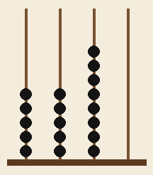

## arc_grid_image

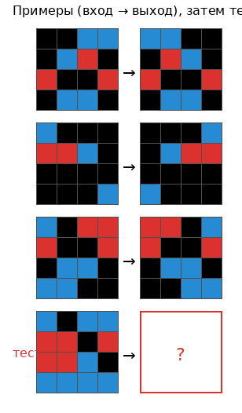

## area_read / under_curve

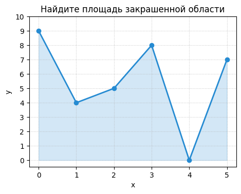

## arrow_path / steps

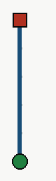

## balance_scale / equal_arm

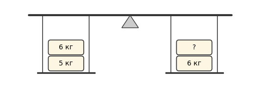

## bar_chart_read / max_category

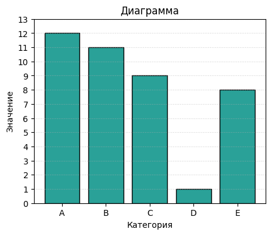

## block_tower / total

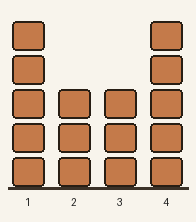

## boolean_circuit_image / evaluate

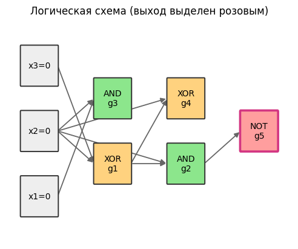

## box_plot / median

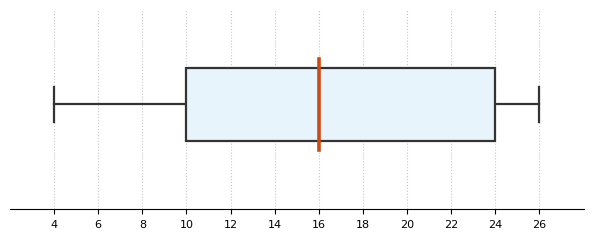

## chessboard_count / total

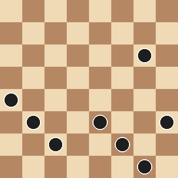

## circuit_resistance_image / resistor

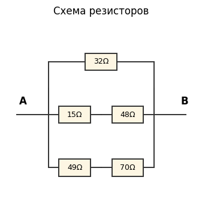

## clock_read

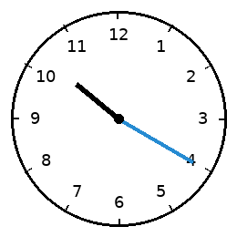

## clock_row / hour_sum

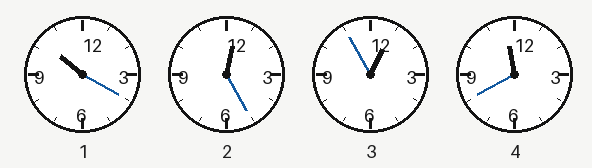

## convex_hull_image / convex_hull

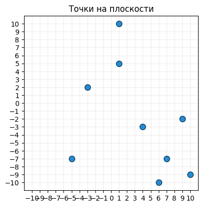

## dfa_image

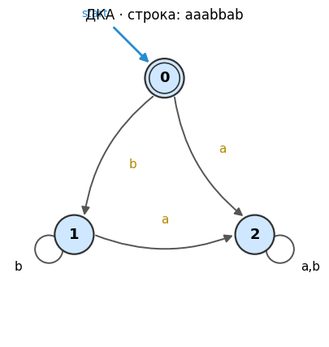

## dice_read / sum

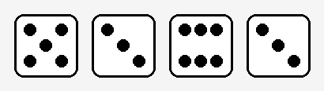

## domino_image / pips

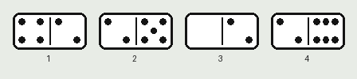

## function_plot_read / count_roots

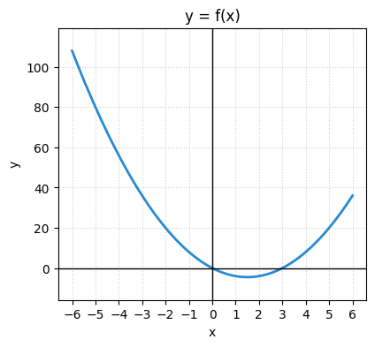

## game_of_life_image

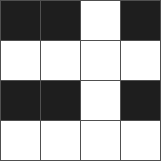

## geometry_figure / right_triangle_area

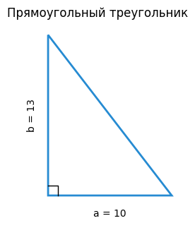

## graph_coloring_image / chromatic

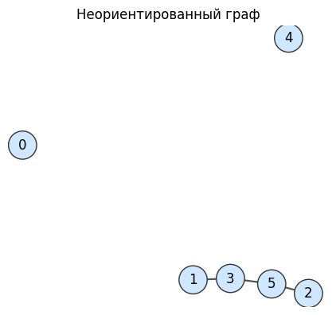

## grid_color_count / count_color

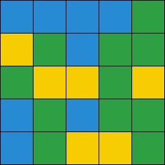

## grid_navigation_image / maze

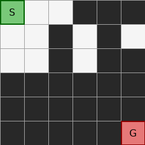

## grid_squares / all

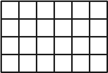

## kinematics_graph / displacement

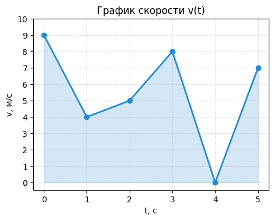

## line_plot_read / value_at

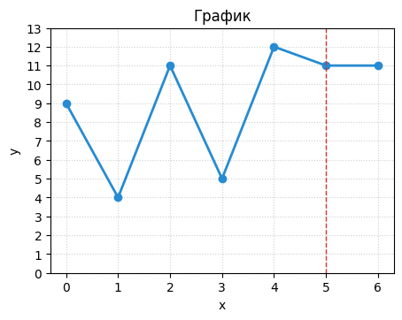

## magic_square_image

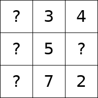

## mastermind_image

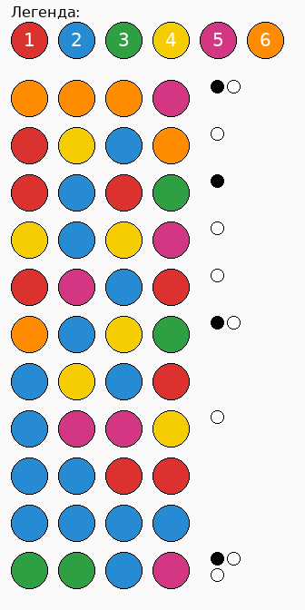

## max_flow_image

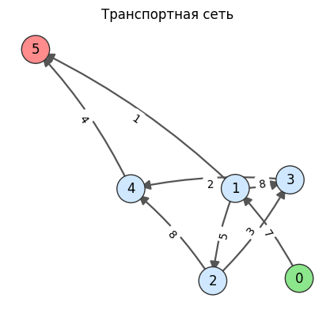

## minesweeper_image

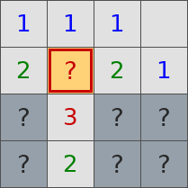

## mst_image

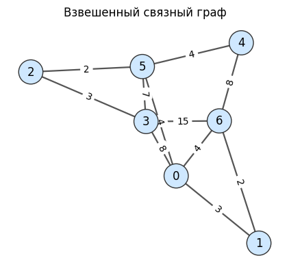

## number_line / value

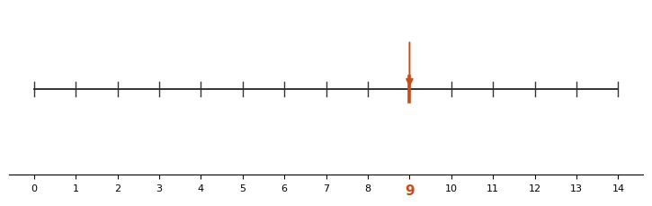

## pie_chart_read / largest

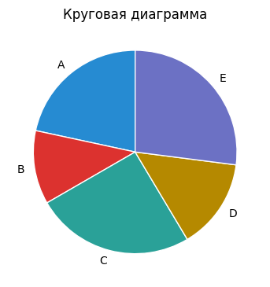

## projectile_graph / range

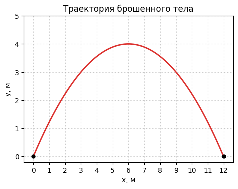

## pv_cycle_image / net_work

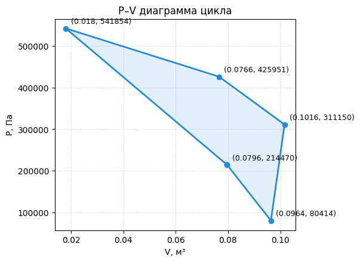

## queens_check_image

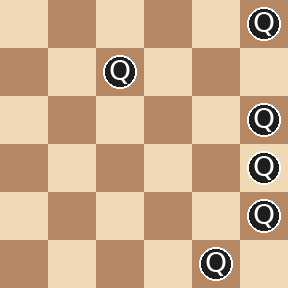

## scatter_plot / trend

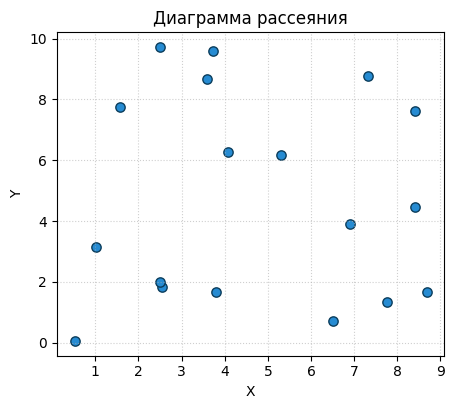

## shoelace_image

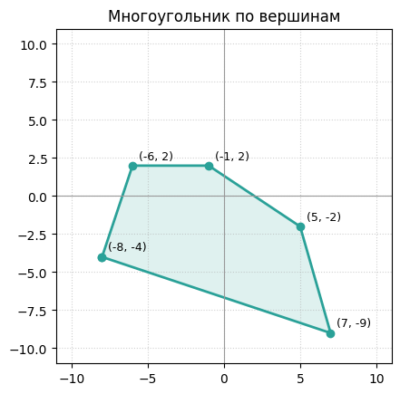

## shortest_path_image

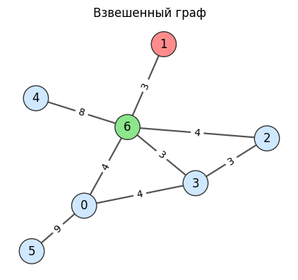

## sliding_puzzle_image / solvable

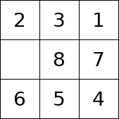

## slope_read / slope

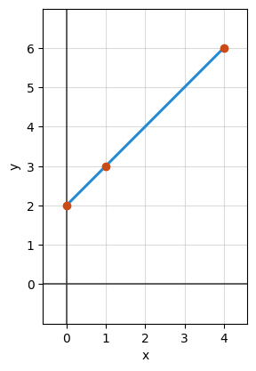

## stats_histogram / mode

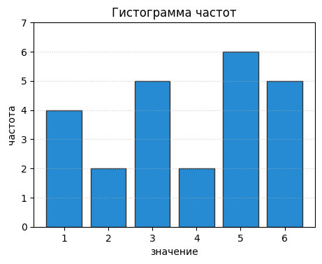

## sudoku_image

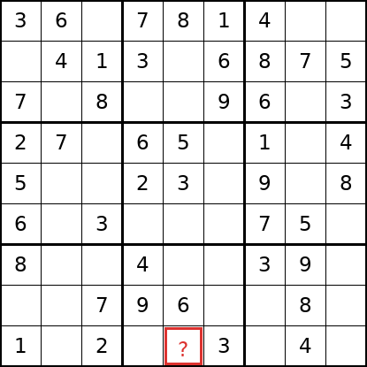

## topological_sort_image / order

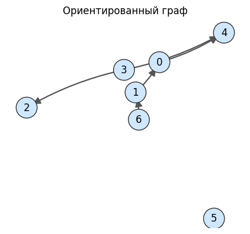

## venn_diagram / intersection

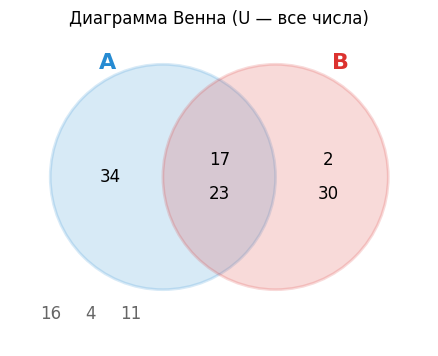
